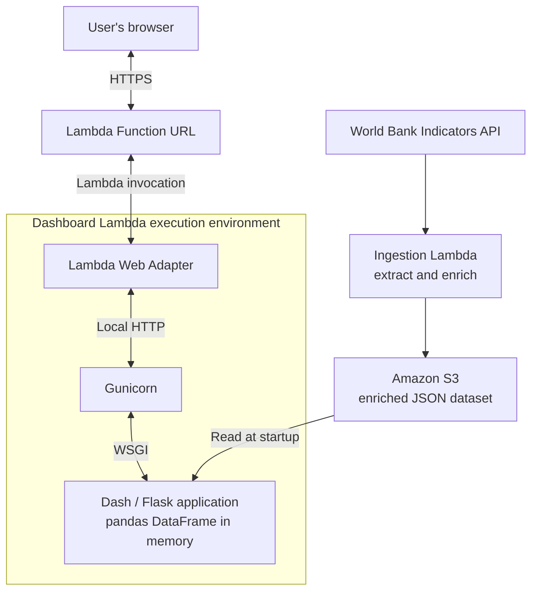
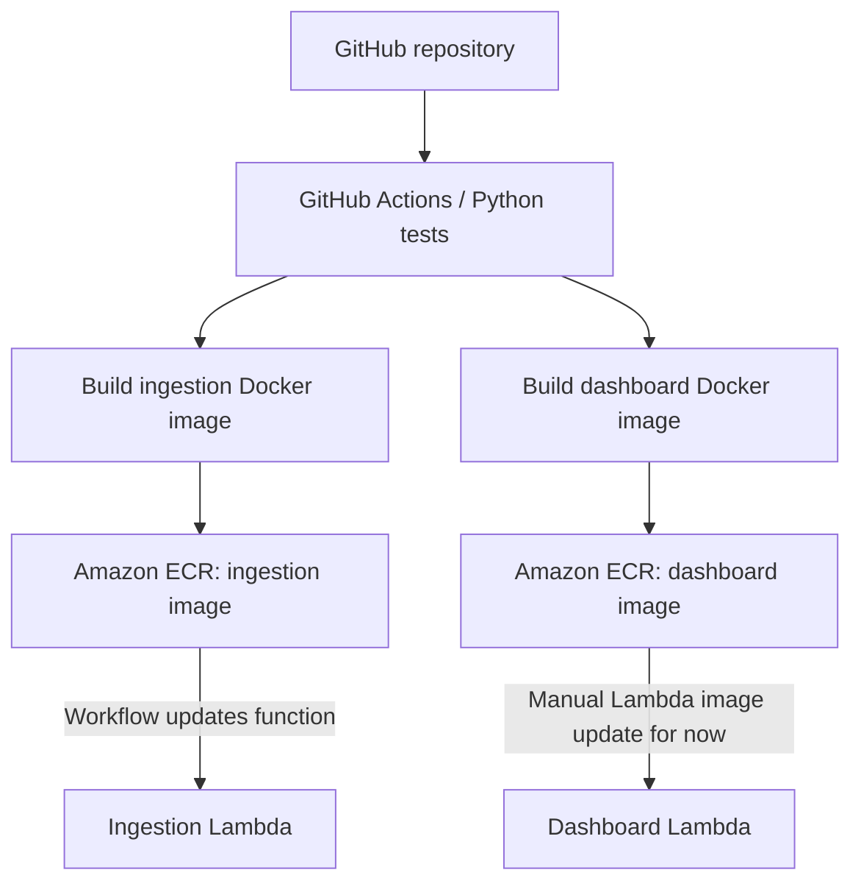

# World Population Explorer

**An interactive, publicly deployed application for exploring historical population data from the World Bank.**

World Population Explorer combines a Python data ingestion pipeline, metadata enrichment, Amazon S3 storage, and an interactive Dash/Plotly dashboard. Visitors can rotate a globe, select an economy, and explore its population history.

**Live dashboard:**[Live dashboard](https://kgywd5fzmf347xiiw2rlz73hm40eiyby.lambda-url.eu-north-1.on.aws/)  
[Live Demo](
https://github.com/user-attachments/assets/b9c95f83-1d33-4023-b44e-0b4245502bc6
)


> **Deployment status:** The ingestion pipeline and interactive dashboard are both deployed on AWS. Dashboard container builds are automated through GitHub Actions; updating the dashboard Lambda to use a newly built image remains a manual deployment step.

## Features

### Ingestion and data preparation

- Retrieves annual observations for the World Bank indicator [`SP.POP.TOTL`](https://data.worldbank.org/indicator/SP.POP.TOTL), from 1970 through the current calendar year, subject to API availability.
- Retrieves economy metadata and enriches observations with region information and aggregate-group flags.
- Retrieves all reported pages for both API endpoints, checks pagination metadata, and verifies retrieved record counts against API-reported totals.
- Retains economy identifiers and ISO3 codes for map matching.
- Preserves missing population observations as `null` rather than interpreting them as zero.
- Publishes the enriched JSON dataset to Amazon S3.

### Interactive dashboard

- Rotatable orthographic globe with a **Viridis** colour scale using the base-10 logarithm of population.
- Hover information showing population values and observation years.
- Globe based on the latest available year covering more than 200 distinct economies with valid population observations and non-empty ISO3 codes.
- Country/economy selection panel showing the latest available observation and a historical population chart.
- Clear-selection control that preserves the globe figure rather than rebuilding it.
- Responsive layout for desktop and smaller screens.

The application displays individual World Bank economies, including territories. World Bank aggregate groups remain in the stored dataset but are excluded from individual-economy visualisations.

## Architecture

### Data and request flow



The two Lambda functions have different responsibilities:

- **Ingestion Lambda:** Retrieves and enriches World Bank data, then publishes the dataset to S3. Deploying ingestion code does not automatically run an ingestion job.
- **Dashboard Lambda:** Starts the containerised web application when invoked. At Python process startup, it reads the dataset from S3 into a pandas DataFrame. Country-selection callbacks filter that in-memory DataFrame; they do **not** call the World Bank API or download S3 data on every click.

The browser communicates with the dashboard through a public **Lambda Function URL**. AWS Lambda Web Adapter translates Lambda events to local HTTP requests handled by Gunicorn, which serves the Dash/Flask application. Some interactions, such as Plotly globe rotation, are rendered in the browser without a server-side callback.

Browser visitors do not need AWS credentials or direct access to the S3 bucket. The dashboard Lambda's execution role provides its S3 read permission.

### Container build and deployment



**Docker** packages each application and its dependencies into a container image. **Amazon ECR** stores the built images; it does not run containers. **AWS Lambda** runs the applications using those images.

## Project status

| Component | Status |
| --- | --- |
| World Bank API ingestion and metadata enrichment | Implemented |
| Pagination and record-count verification | Implemented |
| Ingestion Lambda and S3 output | Deployed |
| Ingestion GitHub Actions deployment | Implemented; manually triggered, updates Lambda image |
| Dash/Plotly interactive frontend and country details | Implemented |
| Production dashboard Dockerfile (Gunicorn + Lambda Web Adapter) | Implemented |
| Dashboard GitHub Actions image build and ECR push | Implemented; manually triggered |
| Dashboard Lambda and public Function URL | Deployed; browser-tested |
| Automatic dashboard Lambda update after image build | Not yet implemented |
| Automatic ingestion schedule and dashboard cache refresh | Not yet implemented |
| Broader data-quality validation | Planned |
| MCP-enabled, agentic World Bank data exploration | Proposed extension; not implemented |

## AWS deployment

### Ingestion

The manually triggered workflow [`.github/workflows/deploy_ingestion.yml`](.github/workflows/deploy_ingestion.yml):

1. Runs the reusable Python CI workflow.
2. Assumes an AWS deployment role using GitHub OIDC.
3. Builds and pushes a version-tagged ingestion image to Amazon ECR.
4. Updates the existing ingestion Lambda and waits for the update to complete.

**Updating the ingestion Lambda image does not execute it.** Invoke the ingestion Lambda separately to refresh the S3 dataset. See [ingestion/README.md](ingestion/README.md) for detailed instructions.

### Dashboard

The manually triggered workflow [`.github/workflows/deploy_dashapp.yml`](.github/workflows/deploy_dashapp.yml):

1. Runs the reusable CI workflow.
2. Authenticates to AWS using GitHub OIDC.
3. Builds the dashboard image for `linux/amd64` from [`dash_app/Dockerfile`](dash_app/Dockerfile).
4. Pushes the uniquely tagged image to the `population-dashboard` ECR repository.
5. Prints the resulting ECR image URI in the GitHub Actions run summary.

**At present, this workflow stops after uploading the image.** The dashboard Lambda was configured separately to use an ECR image. For future releases, update the function to the newly built image URI:

```powershell
$imageUri = "<ECR_IMAGE_URI_FROM_GITHUB_ACTIONS>"

aws lambda update-function-code `
  --function-name population-dashboard `
  --image-uri $imageUri `
  --region eu-north-1

aws lambda wait function-updated-v2 `
  --function-name population-dashboard `
  --region eu-north-1
```

The public HTTPS endpoint is associated with the **dashboard Lambda**, not a separate Lambda function. Retrieve it using:

```powershell
aws lambda get-function-url-config `
  --function-name population-dashboard `
  --query FunctionUrl `
  --output text `
  --region eu-north-1
```

The dashboard runs **Gunicorn** on port `8080` behind **AWS Lambda Web Adapter**. Its runtime execution role has read access to the S3 population object; the GitHub Actions deployment role is a different IAM role used to build and deploy code.

The Function URL is intended for public access without AWS login. Public traffic can incur AWS charges; budgets and monitoring are operational safeguards, **not a guaranteed spending cap**.

## Run locally

Use **Python 3.13** to match the GitHub Actions environment. From the repository root:

```powershell
python -m pip install -r requirements-dev.txt
```

The development requirements include the dashboard and ingestion dependencies. Authenticate with AWS using your normal local credentials or AWS profile. The dashboard needs `s3:GetObject` access to:

```text
s3://webgis-population-app/data/enriched_population_data.json
```

Start the development server:

```powershell
python -m dash_app.app
```

Open **http://127.0.0.1:8050**. This command uses Dash's development server, whereas the deployed container runs Gunicorn.

For more on the UI implementation, see [dash_app/README.md](dash_app/README.md). Its deployment notes also need updating to reflect the live dashboard.

## Tests and CI

Run all Python tests from the repository root:

```powershell
python -m pytest -q
```

Or run only dashboard tests:

```powershell
python -m pytest dash_app/tests -q
```

Tests cover ingestion and pagination, metadata enrichment, data loading and preparation, chart generation, and country-selection callbacks. GitHub Actions runs reusable Python CI on pushes and pull requests. The current [`requirements-dev.txt`](requirements-dev.txt) includes `dash_app/requirements.txt`, so the previously documented missing-dashboard-dependencies issue has been addressed.

These tests do not replace browser-based testing of map rotation, click interactions, resizing, or responsive layout.

## Data interpretation and known limitations

- World Bank economies include territories and non-sovereign entities, not only sovereign states.
- Aggregate entries are identified using World Bank metadata and excluded from individual-economy visualisations.
- Missing population values are preserved as `null`, not converted to zero. Uncoloured land on the globe should not be interpreted as zero population.
- An economy's most recent available observation can be from a different year than the globe's reference year; both are labelled in the application.
- The globe uses a logarithmic colour transform, whereas hover labels and charts display population values.
- Pagination and count checks help detect incomplete retrieval, but do not guarantee a consistent source snapshot or validate every observation.
- Ingestion retries, partial-run recovery, and broader checks using Great Expectations have not yet been implemented.
- Each dashboard Python process loads the S3 dataset at startup. Existing warm Lambda environments may continue to use an older in-memory snapshot after S3 is updated; automatic cache invalidation is not yet implemented.
- Extreme vertical globe rotation can trigger a Plotly rendering issue in which the globe briefly collapses. This remains under investigation.
- AWS bucket, object key, and region are currently configured in Python rather than environment variables.

## Repository structure

| Path | Responsibility |
| --- | --- |
| `ingestion/` | World Bank API extraction, enrichment, S3 upload, and ingestion Lambda packaging |
| `dash_app/` | Dash application, charts, callbacks, CSS, Dockerfile, and dashboard tests |
| `tests/` | Ingestion tests |
| `.github/workflows/ci.yml` | Reusable Python CI |
| `.github/workflows/deploy_ingestion.yml` | Manually triggered ingestion build and Lambda update |
| `.github/workflows/deploy_dashapp.yml` | Manually triggered dashboard image build and ECR push |
| `requirements-dev.txt` | Development and testing dependencies |

## Roadmap

- [ ] Automate the dashboard Lambda image update after a successful GitHub Actions image build.
- [ ] Add repeatable dataset refresh and freshness/status metadata; keep the last successfully loaded dataset available if refreshing fails.
- [ ] Add broader data-quality checks, including schema, range, missingness, and duplicate validation.
- [ ] Investigate and fix the extreme-rotation Plotly rendering issue.
- [ ] Move deployment-specific configuration into environment variables.
- [ ] Explore an **MCP-powered World Bank data agent** that discovers indicators, performs auditable retrieval and transformations, and exposes the underlying sources and queries. This is a future extension, not part of the current application.

## Data source

Population observations come from the [World Bank — Population, total (`SP.POP.TOTL`)](https://data.worldbank.org/indicator/SP.POP.TOTL).

API reference: [World Bank Indicators API documentation](https://datahelpdesk.worldbank.org/knowledgebase/topics/125589-developer-information).

Review World Bank attribution and reuse terms before redistributing data or publishing derivative datasets.
