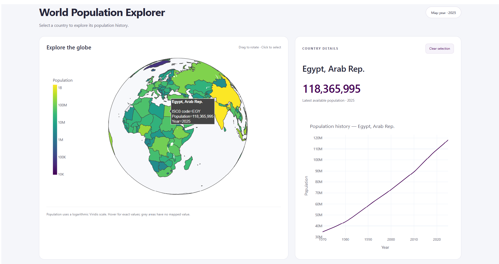
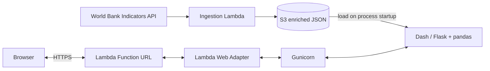
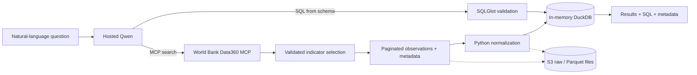

# World Population Explorer

**An AWS-hosted population dashboard with a locally integrated, experimental World Bank analytics agent.**

Explore historical population observations on a rotatable globe, inspect economy-level time series, and browse the engineering work behind an end-to-end environmental/geospatial-style data application.

**[Open the live dashboard](https://kgywd5fzmf347xiiw2rlz73hm40eiyby.lambda-url.eu-north-1.on.aws/)** · **[Watch the demo](https://github.com/user-attachments/assets/b9c95f83-1d33-4023-b44e-0b4245502bc6)**



> **Status (November 2026):** Population ingestion and the globe are deployed to AWS. The multi-indicator analytics prototype is connected to a **local-only Dash AI Data Analyst tab**; it is **not part of the deployed dashboard and is not a public agent service**. See the [agent README](agentic_framework/README.md) for validated capabilities and limitations.

## Two complementary components

| Component | What it does | Maturity |
| --- | --- | --- |
| [Population ingestion](ingestion/README.md) | Retrieves World Bank population observations and metadata, validates pagination and record counts, and writes enriched JSON to S3 | Implemented and deployed; ingestion invoked manually |
| [Population dashboard](dash_app/README.md) | Serves an interactive Dash/Plotly globe and historical population details through AWS Lambda | Implemented and deployed |
| [Agentic analytics framework](agentic_framework/README.md) | Uses Qwen + World Bank Data360 MCP to discover one or more indicators, normalize data, and execute guarded SQL; connected to a local-only Dash tab | Local tested prototype; not deployed |

## Dashboard features

- **Complete, checked ingestion:** Retrieves the World Bank `SP.POP.TOTL` indicator from 1970 onward, requests all API pages, and checks reported counts and pagination metadata.
- **Metadata enrichment:** Preserves economy identifiers, ISO3 map codes, region labels, and aggregate flags; missing values remain `null` rather than becoming zero.
- **Interactive globe:** Rotatable Plotly orthographic map, logarithmic Viridis color scaling, and selection of individual World Bank economies.
- **Linked analytical views:** Latest available population value and historical chart for the selected economy; clear-selection support and responsive interface.
- **Serverless delivery:** Python/Dash behind Gunicorn and AWS Lambda Web Adapter; data read from S3 when each application process starts.
- **Engineering workflow:** Python tests, Docker images, GitHub Actions and Amazon ECR.

*The visualization represents World Bank economies, including some territories, not just sovereign states. Aggregate groups remain in source data but are excluded from individual-economy maps.*

## Architecture

### Deployed population application



- **Ingestion:** A separate container-based Lambda collects and enriches population data and writes to S3. Updating the ingestion Lambda image does **not** run ingestion; invocation is a separate step.
- **Serving:** A container-based dashboard Lambda receives HTTP traffic through its Function URL, translated by Lambda Web Adapter to Gunicorn/Dash. The dashboard does not query the World Bank on every click.
- **Caching limitation:** An already warm dashboard process may retain an older DataFrame after S3 is refreshed. Scheduled ingestion and automatic in-process refresh are not yet implemented.

### Experimental agentic analytics (separate from the live application)



The agent diagram summarizes the **locally implemented prototype**. Qwen decomposes questions into measurement requirements and discovers each indicator independently. Validated annual observations are combined in a shared long-form DuckDB table; elementary multi-indicator comparisons can use conditional aggregation, while more complex SQL is intentionally restricted. S3 writes can be skipped using `AGENT_SKIP_S3=1`; cache-hit/freshness reuse is not implemented. A two-indicator Egypt comparison was live-tested; broader analyses are not guaranteed. See [implementation details](agentic_framework/README.md) and [architecture decisions](agentic_framework/docs/DECISIONS.md).

## Technology and repository structure

| Area | Main tools | Path |
| --- | --- | --- |
| API ingestion | Python, World Bank API, boto3, AWS Lambda | [`ingestion/`](ingestion/) |
| Interactive visualization | Dash, Plotly, pandas, CSS | [`dash_app/`](dash_app/) |
| Cloud delivery | Docker, Gunicorn, Lambda Web Adapter, ECR, S3 | [`dash_app/Dockerfile`](dash_app/Dockerfile), [`ingestion/Dockerfile`](ingestion/Dockerfile) |
| CI / deployments | pytest, GitHub Actions, AWS OIDC | [`.github/workflows/`](.github/workflows/) |
| Agentic analytics | Qwen, Hugging Face InferenceClient (DeepInfra configured), MCP, DuckDB, SQLGlot, pandas, Parquet/S3 | [`agentic_framework/`](agentic_framework/) |

The project illustrates georeferenced **country-level visualization**, not advanced spatial analysis such as raster transformations or spatial joins.

## Status and deployment boundaries

| Capability | Status |
| --- | --- |
| World Bank population ingestion, enrichment, pagination checks | Implemented |
| S3 population dataset and dashboard Lambda / Function URL | Deployed in AWS |
| Interactive globe, selection and time-series chart | Implemented and browser-tested |
| GitHub Actions tests and container-image publishing | Implemented |
| Ingestion workflow updates ingestion Lambda image | Implemented; manually triggered |
| Dashboard workflow updates dashboard Lambda image | **Not implemented**; update remains manual after ECR push |
| Scheduled population ingestion / warm-process refresh | Not implemented |
| World Bank Data360 agent: discovery, retrieval, normalization, guarded SQL | Implemented in prototype |
| Agent S3 raw JSON / Parquet writes | Implemented in prototype; optional |
| Agent S3 cache lookup, freshness, versioned audit trail | Not implemented |
| Agent UI in local Dash development | Implemented locally; not deployed |
| Grounded natural-language answer from SQL results | Not implemented |
| Public or protected agent deployment | Not implemented |

## Getting started

### Run the population dashboard locally

Use Python 3.13. From the repository root:

```powershell
python -m pip install -r requirements-dev.txt
# Configure local AWS credentials with S3 read access to the population object
python -m dash_app.app
```

Open `http://127.0.0.1:8050`. The local entry point uses the Dash development server; the deployed image uses Gunicorn. By default, the dashboard reads `s3://webgis-population-app/data/enriched_population_data.json` at startup. See [dashboard setup](dash_app/README.md) and [ingestion instructions](ingestion/README.md).

### Run tests

```powershell
python -m pytest -q
# or dashboard-only:
python -m pytest dash_app/tests -q
```

These tests validate application and ingestion logic; they do not replace browser-based checks for globe rotation or responsive behavior. Agent live tests additionally require network access, model credentials, and sometimes AWS credentials; see the [agent README](agentic_framework/README.md).

### Build and deploy

- [Ingestion deployment](.github/workflows/deploy_ingestion.yml): manually initiated; runs CI, builds and pushes an ECR image, **updates ingestion Lambda**. Then separately invoke ingestion to refresh S3.
- [Dashboard image build](.github/workflows/deploy_dashapp.yml): manually initiated; runs CI, builds and pushes the dashboard container image to ECR. **Does not update the dashboard Lambda code**. Follow [dashboard deployment instructions](dash_app/README.md) for the manual image update.

AWS charges may be incurred by the public endpoint; budgets and alerts are not hard usage limits.

## Known limitations and next steps

- No scheduled ingestion, automatic S3 freshness metadata, or cache invalidation for warm dashboard processes.
- No comprehensive content-level data-quality validation beyond the existing ingestion checks.
- The Plotly globe can exhibit a rendering issue under extreme vertical rotation.
- Some deployment settings remain hard-coded; the dashboard Lambda image update is manual.
- The agent is not connected to the public dashboard; its model output and SQL results require careful verification and are not production-safe by default.

Near-term priorities: grounded synthesis of SQL results into evidence-based answers; visual results in the local Dash tab; bounded background execution, authentication and cost controls before a protected agent deployment; and future S3 caching and more expressive guarded SQL.

## Data source and attribution

Population data: [World Bank — Population, total (`SP.POP.TOTL`)](https://data.worldbank.org/indicator/SP.POP.TOTL). Source API: [World Bank Indicators API](https://datahelpdesk.worldbank.org/knowledgebase/topics/125589-developer-information). Agent source: [World Bank Data360 MCP](https://worldbank.github.io/data360-mcp/). The two World Bank interfaces may expose different datasets, definitions, or revisions; their observations should not be treated as automatically identical.

For more on engineering trade-offs, see [Architecture Decision Log](agentic_framework/docs/DECISIONS.md).