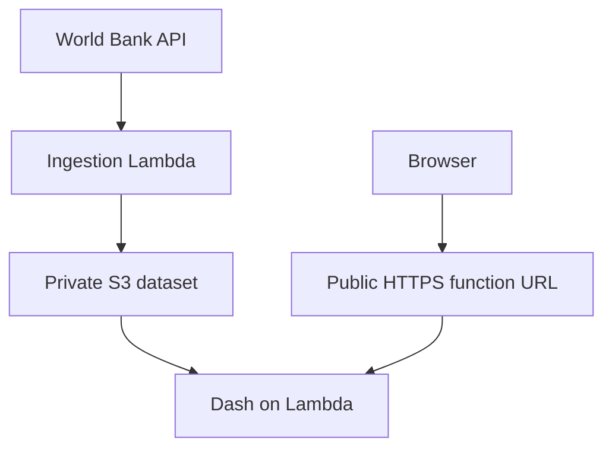

# World Population Explorer

An interactive globe for exploring World Bank population data and an AWS ingestion
pipeline that prepares the data behind it. Select an economy to view its population
history from 1970 onward.

## What works

- Historical API ingestion with pagination and total-record checks for both endpoints.
- Region enrichment and explicit separation of economies and aggregate groups.
- Containerised ingestion on AWS Lambda, publishing JSON to Amazon S3.
- Dash globe with logarithmic population colours, click-to-view history and reset.
- Responsive interface, a production Gunicorn entry point and health endpoint.
- Automated tests and manual GitHub Actions deployment workflows.

**Deployment status:** the ingestion deployment was previously verified (see its
[README](ingestion/README.md)). The dashboard now includes AWS infrastructure and a
deployment workflow, but a live dashboard deployment has not yet been verified.
After the first successful deployment, the public URL appears in the GitHub Actions
run summary; add it here together with a screenshot of the running dashboard.

## Architecture



The dashboard runs Gunicorn inside a container. AWS Lambda Web Adapter translates
Lambda HTTP requests to the web server. The browser receives charts from Dash;
AWS credentials stay on the server. The dashboard role can read only the configured
S3 object, while ingestion uses its own write permissions.

Each deployment workflow runs CI before publishing an image to ECR. Ingestion
updates its existing Lambda. Dashboard deployment creates or updates a separate
CloudFormation stack. Deployments are **manually triggered**, not automatic on push.

## Run locally

Requires Python 3.13 and AWS credentials with `s3:GetObject` for the dataset.
From the repository root:

```sh
python -m venv .venv
# Activate the virtual environment using your shell's command.
python -m pip install -r requirements-dev.txt
python -m pytest -q
python -m dash_app.app
```

Open http://127.0.0.1:8050. Boto3 uses your AWS profile or environment credentials.
Set `POPULATION_BUCKET`, `POPULATION_KEY` and `AWS_REGION` to override defaults.
Do not put credentials into the image or repository.

For Docker, AWS setup, deployment and troubleshooting, see the
[dashboard guide](dash_app/README.md). For the API, data format and ingestion
verification, see the [ingestion guide](ingestion/README.md).

## Data interpretation and limits

- Economies include territories as well as sovereign countries; aggregates are
  excluded from the map and individual history charts.
- The map uses the latest year with non-missing values and ISO3 codes for more than
  200 distinct economies. Historical observations span 1970 onward, subject to availability.
- Colour is logarithmic; hover shows the actual population. Missing values are not zero.
- Pagination checks detect some incomplete responses; they do not validate every value.
  Great Expectations and broader data-quality checks are not implemented.
- Data is loaded once per web-server worker. Warm Lambda environments can show the
  previous snapshot after ingestion until recycled or the dashboard is redeployed.
- No retries or partial-run recovery are implemented in ingestion.
- The dashboard is intended as a small public portfolio demo. Cold starts can delay
  the first request. Hosting and requests incur AWS charges.

## Repository

| Path | Purpose |
| --- | --- |
| `ingestion/` | API retrieval, transformation and Lambda packaging |
| `dash_app/` | App, charts, callbacks, CSS, Dockerfile and tests |
| `tests/` | Ingestion tests |
| `infra/dashboard.yml` | Dashboard Lambda, read role, logs and public URL |
| `.github/workflows/` | CI and manual deployments |

## Verification

The test suite includes pagination failure handling, enrichment, S3 loading,
chart generation, HTTP routes, CSS delivery, country selection and reset.
CI installs both components' dependencies and builds the dashboard container.
Live AWS checks are a separate deployment step: health endpoint and Dash layout.

Data source: [World Bank — Total population](https://data.worldbank.org/indicator/SP.POP.TOTL).
See the [World Bank data terms](https://www.worldbank.org/en/about/legal/terms-of-use-for-datasets)
for attribution and reuse conditions.
