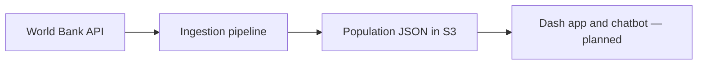

# World Population Interactive Visualisation

A data project for exploring World Bank population data through an interactive
Dash and Plotly application. It combines API ingestion, data transformation,
testing, and cloud deployment.

The ingestion pipeline is deployed on AWS. The interactive application and
historical analysis are planned.

## Project status

The ingestion pipeline retrieves the latest available population observations,
enriches them with World Bank region and aggregate metadata, and writes the
results as JSON to Amazon S3.

The pipeline runs as a container image on AWS Lambda. GitHub Actions runs
automated tests and provides a manually triggered deployment workflow.

The current ingestion request uses `mrv=1`, so it does not yet provide the
historical data needed for analysis across years.

## Questions the project aims to answer

- How has an economy's population changed over time?
- How do population levels and growth patterns compare across economies?
- How do aggregate groups compare with individual economies?

## Architecture

The current ingestion path is:

**World Bank API → AWS Lambda → Amazon S3**

The Lambda retrieves and transforms the data before storing the enriched JSON
in S3. The records distinguish individual economies from aggregate groups.
World Bank economies can include territories as well as sovereign countries.

The planned application path is:

**Amazon S3 → Dash application → interactive visualisations**



The deployment workflow is:

**GitHub Actions → tests → Docker image → Amazon ECR → AWS Lambda**

The ingestion deployment is triggered manually from GitHub Actions. Invoking
the Lambda to refresh the dataset is a separate action.

## Planned Dash application

The project will include an interactive web application built with Dash and
Plotly. The application is intended to read the processed population data
stored in Amazon S3 and display it through interactive visualisations.

Planned features include:

- A world map showing population by economy.
- Filters for selecting economies and exploring their population data.
- A distinction between individual economies and aggregate groups.
- Historical charts and comparisons once historical data ingestion is available.

The Dash application is still to be developed. Its final features, data-access
strategy, and cloud hosting configuration have not yet been implemented or
validated.

## Repository structure

```text
.github/workflows/        CI and ingestion deployment workflows
ingestion/                Lambda code, Dockerfile and runtime dependencies
dash_app/                 Planned dashboard
tests/                    Automated tests
requirements-dev.txt      Development and test dependencies
```

See [ingestion/README.md](ingestion/README.md) for the data structure, local
setup, deployment, and verification steps.

## Local development

From the repository root in PowerShell, install the development dependencies:

```powershell
python -m pip install -r requirements-dev.txt
```

Run the tests:

```powershell
python -m pytest -q
```

The CI workflow runs tests automatically on pushes and on pull requests
targeting `main`. The manual ingestion deployment workflow also runs tests
before building and deploying the image.

## Data quality and interpretation

- The World Bank API includes both individual economies and aggregate groups.
  These should be distinguished when comparing or summing populations.
- World Bank economies can include territories as well as sovereign countries.
- Missing population values are retained as `None` in Python and `null` in JSON.
- Records without matching country metadata receive `null` for `region` and
  `is_aggregate`.
- Observation years are currently stored as strings.
- The current requests use `per_page=300`. Pagination and completeness checks
  still need to be implemented.

## Technology

| Component | Purpose |
| --- | --- |
| Python, urllib, and JSON | API requests and data transformation |
| Boto3 | Writing the output to Amazon S3 |
| pytest | Automated testing |
| Docker | Packaging the ingestion function |
| Amazon ECR | Storing the ingestion container image |
| AWS Lambda | Running the ingestion pipeline |
| Amazon S3 | Storing the enriched JSON |
| GitHub Actions | Continuous integration and manual deployment |
| Dash and Plotly | Planned interactive application and visualisations |

## Roadmap

- [x] Retrieve and enrich the latest population observations.
- [x] Add a transformation unit test and automated CI.
- [x] Build and test a Lambda-compatible Docker image locally.
- [x] Deploy the ingestion image to ECR and Lambda.
- [x] Write enriched JSON to S3.
- [x] Add a manually triggered ingestion deployment workflow.
- [ ] Handle API pagination and validate ingestion completeness.
- [ ] Retrieve historical population observations.
- [ ] Build an interactive Dash application.
- [ ] Deploy the interactive application.

## Data source

Population data and metadata come from the
[World Bank Indicators API](https://datahelpdesk.worldbank.org/knowledgebase/topics/125589-developer-information).

Consult the World Bank's attribution and usage terms when publishing the data.
