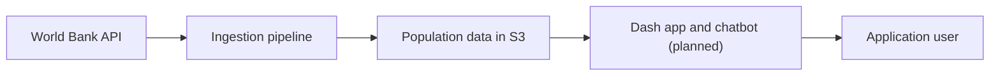

# World Population Interactive Visualisation

A data project for exploring World Bank population data through an interactive
Dash and Plotly application. It combines API ingestion, data transformation,
testing, and cloud deployment.

The ingestion pipeline is deployed on AWS and retrieves historical observations.
The interactive application and historical visualisations are planned.

## Project status

The ingestion pipeline retrieves annual population observations from 1970 through
the current calendar year, enriches them with World Bank region and aggregate
metadata, and writes the results as JSON to Amazon S3. Records preserve both
two-character country identifiers and the provider’s three-character codes.

The pipeline runs as a container image on AWS Lambda. GitHub Actions runs
automated tests and provides a manually triggered deployment workflow.

Both World Bank requests use pagination, requesting up to 3,000 records per page.
The pipeline checks page metadata and the total record count before publishing.

## Questions the project aims to answer

- How has an economy's population changed over time?
- How do population levels and growth patterns compare across economies?
- How do aggregate groups compare with individual economies?

## Architecture

The project has two components connected through Amazon S3:



The **ingestion pipeline** retrieves and enriches World Bank data, then stores
the result in S3. The **planned application** will read that data and let
users explore it through interactive visualisations and, potentially, a
chatbot.

For details, see:

- [Ingestion pipeline](ingestion/README.md) — data processing and deployment.
- [Planned Dash application](dash_app/README.md) — the proposed user-facing
  workflow.

The deployment workflow is:

**GitHub Actions → tests → Docker image → Amazon ECR → AWS Lambda**

The ingestion deployment is triggered manually from GitHub Actions. Invoking
the Lambda to refresh the dataset is a separate action.

## Planned Dash application

The project will include an interactive web application built with Dash and
Plotly. The application is intended to read the processed population data
stored in Amazon S3 and display it through interactive visualisations.

Planned features include:

- A world map showing population by economy.
- Filters for selecting economies and exploring their population data.
- A distinction between individual economies and aggregate groups.
- Historical charts and comparisons using the ingested observations.

The Dash application is still to be developed. Its final features, data-access
strategy, and cloud hosting configuration have not yet been implemented or
validated.

## Repository structure

```text
.github/workflows/        CI and ingestion deployment workflows
ingestion/                Lambda code, Dockerfile and runtime dependencies
dash_app/                 Planned dashboard
tests/                    Automated tests
requirements-dev.txt      Development and test dependencies
```

See [ingestion/README.md](ingestion/README.md) for the data structure, local
setup, deployment, and verification steps.

## Local development

From the repository root in PowerShell, install the development dependencies:

```powershell
python -m pip install -r requirements-dev.txt
```

Run the tests:

```powershell
python -m pytest -q
```

The CI workflow runs tests automatically on pushes and on pull requests
targeting `main`. The manual ingestion deployment workflow calls the reusable
CI workflow and waits for it to succeed before building and deploying the image.

## Data quality and interpretation

- The World Bank API includes both individual economies and aggregate groups.
  These should be distinguished when comparing or summing populations.
- World Bank economies can include territories as well as sovereign countries.
- Missing population values are retained as `None` in Python and `null` in JSON.
- Records without matching country metadata receive `null` for `region` and
  `is_aggregate`.
- Observation years are currently stored as strings.
- Both requests use `per_page=3000` and retrieve all reported pages. Page and
  total-count checks catch some incomplete responses, but do not guarantee a
  consistent source snapshot or independently validate the data.

## Technology

| Component | Purpose |
| --- | --- |
| Python, urllib, and JSON | API requests and data transformation |
| Boto3 | Writing the output to Amazon S3 |
| pytest | Automated testing |
| Docker | Packaging the ingestion function |
| Amazon ECR | Storing the ingestion container image |
| AWS Lambda | Running the ingestion pipeline |
| Amazon S3 | Storing the enriched JSON |
| GitHub Actions | Continuous integration and manual deployment |
| Dash and Plotly | Planned interactive application and visualisations |

## Roadmap

- [x] Retrieve and enrich historical population observations from 1970 onward.
- [x] Add a transformation unit test and automated CI.
- [x] Build and test a Lambda-compatible Docker image locally.
- [x] Deploy the ingestion image to ECR and Lambda.
- [x] Write enriched JSON to S3.
- [x] Add a manually triggered ingestion deployment workflow.
- [x] Handle API pagination and check reported record totals.
- [x] Preserve three-character country codes for map matching.
- [ ] Add retry and partial-run recovery if needed.
- [ ] Profile the dataset and implement a Great Expectations validation suite.
- [ ] Move bucket configuration outside the Python code.
- [ ] Build an interactive Dash application.
- [ ] Deploy the interactive application.

## Data source

Population data and metadata come from the
[World Bank Indicators API](https://datahelpdesk.worldbank.org/knowledgebase/topics/125589-developer-information).

Consult the World Bank's attribution and usage terms when publishing the data.
