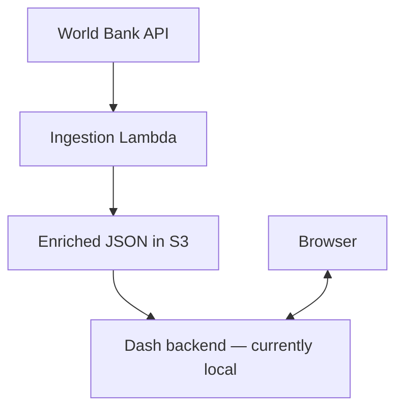

# World Population Explorer

An interactive application for exploring historical World Bank population
data, supported by a Python ingestion pipeline deployed on AWS.

The project connects API ingestion, metadata enrichment, cloud storage and
interactive visualisation. Users can rotate a globe, select an economy and
explore its population history.

## Project status

| Component | Status |
| --- | --- |
| Historical ingestion and metadata enrichment | Implemented |
| Pagination and record-count checks | Implemented |
| Ingestion on AWS Lambda with output in S3 | Deployed |
| GitHub Actions ingestion deployment | Implemented; manually triggered |
| Interactive Dash application | Implemented and run locally |
| Dashboard styling and country details panel | Implemented |
| Dashboard deployment to AWS | Pending |
| Broader data-quality validation | Planned |

## Features

### Data ingestion

- Retrieves annual population observations from 1970 through the current
  calendar year, subject to availability in the World Bank API.
- Retrieves country metadata and enriches observations with region names
  and aggregate-group flags.
- Preserves country identifiers and ISO3 codes for map matching.
- Fetches all reported pages from both API endpoints.
- Checks pagination metadata and compares retrieved record counts with
  the API totals before publishing.
- Writes the enriched dataset as JSON to Amazon S3.

### Interactive dashboard

- Displays an interactive globe using a logarithmic Viridis colour scale.
- Shows exact population values and observation years on hover.
- Uses the latest year with available population values and non-empty
  ISO3 codes for more than 200 distinct economies.
- Opens a details panel when an economy is selected.
- Displays its latest available population, observation year and
  historical population chart.
- Clears the selection without replacing the globe figure.
- Includes CSS layouts for desktop and smaller screens.

The dashboard displays individual economies, including territories.
World Bank aggregate groups are excluded from the globe and country
history charts.

## Architecture



The ingestion pipeline retrieves and prepares the data. The Dash backend
reads the stored dataset from S3 at startup and serves the interactive
application to the browser.

The browser does not need AWS credentials or direct access to the bucket.

## Deployment

### Ingestion: implemented

The ingestion deployment runs through GitHub Actions:

1. Run the reusable CI workflow.
2. Authenticate with AWS using GitHub OIDC.
3. Build the ingestion Docker image.
4. Push a uniquely tagged image to Amazon ECR.
5. Update the existing ingestion Lambda and wait for the update to finish.

The workflow is triggered manually from GitHub Actions and deploys from
`main`. Deploying code does not invoke the ingestion function; refreshing
the dataset is a separate action.

See [ingestion/README.md](ingestion/README.md) for setup and verification.

### Dashboard: next step

The intended deployment process is also through GitHub Actions:
tests, container build, ECR upload and deployment to a separate dashboard
Lambda.

The planned runtime uses Gunicorn and AWS Lambda Web Adapter, with an HTTPS
endpoint for browser access. The dashboard execution role will need read
access to the population object in S3.

This deployment is not yet implemented in the current repository:

- `.github/workflows/deploy_dashapp.yml` is empty.
- `dash_app/Dockerfile` still contains the ingestion Lambda template.
- A production server entry point and runtime dependencies still need
  to be added.

Docker Desktop is not required for the intended GitHub Actions deployment.

## Local setup

Use Python 3.13 to match the CI environment.

From the repository root, install both sets of dependencies:

```powershell
python -m pip install -r requirements-dev.txt -r dash_app/requirements.txt
```

Configure AWS credentials using your normal local authentication method.
The dashboard requires permission to read:

```text
s3://webgis-population-app/data/enriched_population_data.json
```

Start the application:

```powershell
python -m dash_app.app
```

Open http://127.0.0.1:8050.

The current entry point runs Dash in development mode. It is intended for
local use, not public hosting.

## Tests and CI

Run the test suite from the repository root:

```powershell
python -m pytest -q
```

Tests cover ingestion, metadata enrichment, S3 loading, data preparation,
figure generation and country-selection callbacks.

GitHub Actions runs CI on pushes and pull requests targeting `main`.
The ingestion deployment also calls the reusable CI workflow.

**Current CI dependency gap:** CI installs only `requirements-dev.txt`,
which does not yet include the dashboard requirements. This must be
corrected so that dashboard tests have their dependencies available in
a clean CI environment.

Automated Python tests do not replace browser checks for globe rotation,
click interactions, resizing and chart layout.

## Data interpretation and limitations

- World Bank economies include territories as well as sovereign countries.
- Aggregate records remain in the stored dataset but are excluded from
  the dashboard's individual-economy views.
- Missing population values are preserved as null and are not treated
  as zero.
- Records without matching metadata have null region and aggregate fields.
- Observation years are stored as strings in JSON and converted to integers
  for the dashboard.
- The selected economy's latest available observation may differ from the
  year shown on the globe. Both years are labelled.
- Pagination checks help detect incomplete retrievals but do not validate
  every value or guarantee a consistent snapshot across API requests.
- Ingestion retries, partial-run recovery and Great Expectations validation
  are not implemented.
- The dashboard loads data at startup. Restart it after ingestion to load
  a newly published dataset.
- Bucket, object key and region settings are currently defined in code.
- Browser layout and interaction checks remain part of manual verification.

## Repository structure

| Path | Purpose |
| --- | --- |
| `ingestion/` | API retrieval, enrichment, S3 writing and Lambda packaging |
| `dash_app/` | Dashboard, charts, callbacks, CSS and dashboard tests |
| `tests/` | Ingestion tests |
| `.github/workflows/ci.yml` | Reusable Python CI workflow |
| `.github/workflows/deploy_ingestion.yml` | Manual ingestion deployment |
| `.github/workflows/deploy_dashapp.yml` | Dashboard deployment placeholder |
| `requirements-dev.txt` | Development and test dependencies |

## Next steps

- [ ] Include dashboard dependencies in CI.
- [ ] Replace the dashboard Dockerfile with web-app packaging.
- [ ] Add the production server entry point and dependencies.
- [ ] Implement dashboard deployment through GitHub Actions.
- [ ] Configure dashboard AWS resources and S3 read permissions.
- [ ] Verify the deployed application and add its live URL.
- [ ] Add a screenshot of the verified dashboard.
- [ ] Add broader data-quality checks.

## Data source

Population observations use the World Bank indicator
[SP.POP.TOTL — Population, total](https://data.worldbank.org/indicator/SP.POP.TOTL).

API documentation:
[World Bank Indicators API](https://datahelpdesk.worldbank.org/knowledgebase/topics/125589-developer-information).

Consult the World Bank's attribution and usage terms when publishing or
redistributing the data.