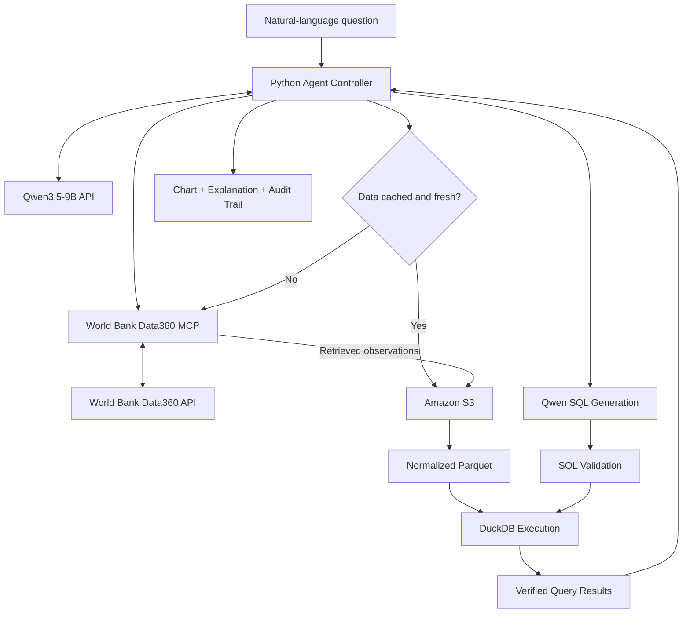

# World Bank Agentic Analytics Framework

An experimental AI engineering framework for verifiable, natural-language analysis of World Bank development data.

**Status:** Architecture defined — implementation pending.

This project extends the World Population Explorer with a model-driven analytical workflow using an open-weight language model, the Model Context Protocol (MCP), ELT, and SQL.

The goal is not simply to build a chatbot. It is to build an analytical system where users can inspect the data sources, transformations, queries, and calculations behind AI-generated answers.

## 1. Objectives

The framework should allow users to:

- Ask questions about World Bank development indicators in natural language.
- Discover relevant datasets and indicator definitions automatically.
- Retrieve observations through the World Bank Data360 MCP server.
- Store raw observations for reuse and reproducibility.
- Transform and query retrieved data using SQL.
- Generate charts and explanations grounded in verified query results.
- Inspect the SQL, source metadata, and data snapshots used.
- Understand when an answer is incomplete, ambiguous, or unsupported.

### Core engineering principles

1. **LLM for interpretation:** The model interprets questions, selects tools, and generates analytical queries.
2. **Python for orchestration:** Application code validates and executes the model's proposed actions.
3. **MCP for data access:** A standardized interface connects the controller to World Bank Data360 tools.
4. **ELT for reproducibility:** Raw data is persisted before transformation.
5. **DuckDB for computation:** Numerical calculations are performed by a deterministic SQL engine.
6. **Transparent outputs:** Each answer includes sufficient metadata to reproduce the analysis.
7. **Bounded execution:** Every model request and tool invocation is subject to limits.

## 2. Technology Stack

| Component | Technology | Responsibility |
| --- | --- | --- |
| Language | Python 3.13 | Application and agent logic |
| Language model | Qwen3.5-9B | Interpretation, tool selection, SQL generation |
| Inference | Hosted model API | Run model without local GPU infrastructure |
| Tool protocol | MCP | Standardized tool discovery and invocation |
| Data provider | World Bank Data360 | Indicators, metadata, time series |
| Raw storage | Amazon S3 | Preserve retrieved source responses |
| Analytical format | Apache Parquet | Efficient structured data storage |
| Query engine | DuckDB | SQL transformations and calculations |
| SQL parsing | SQLGlot | Inspect and validate generated SQL |
| Data processing | pandas / PyArrow | Normalize and validate records |
| Validation | Pydantic | Validate structured model outputs |
| Evaluation | pytest + reference SQL | Test SQL and agent correctness |
| Future frontend | Dash + Plotly | Interactive analytics interface |

### Model selection

The initial model is Qwen3.5-9B.

The model will be accessed through a hosted inference API, avoiding the need for a local GPU or a dedicated AWS inference instance.

The inference provider is not yet finalized.

The model client should use a provider-independent interface wherever practical.

### Why not LangGraph initially?

The MVP uses ordinary Python functions to orchestrate the agent workflow.

LangGraph is a possible future addition if the project needs more complex branching, checkpointing, retries, or resumable workflows.

The first objective is to understand and implement the underlying agent loop ourselves.

## 3. System Architecture



The diagram represents the logical architecture, not an existing deployment.

The Python controller manages the workflow. The LLM does not directly execute arbitrary Python, SQL, or external tools.

## 4. End-to-End Workflow

### Stage A — Interpret the user question

Example:

> Compare GDP per capita in Egypt and Switzerland between 2000 and 2024.

The controller sends the question to Qwen and requests a structured analytical plan.

Illustrative output:

```json
{
  "metric": "GDP per capita",
  "countries": ["Egypt", "Switzerland"],
  "start_year": 2000,
  "end_year": 2024,
  "operation": "compare_time_series",
  "visualization": "line_chart"
}
```

Python validates the structure using Pydantic.

The model may identify ambiguities, such as current versus constant US dollars.

The plan is not treated as verified until indicator selection and metadata checks succeed.

### Stage B — Discover the appropriate indicator

The controller connects to the World Bank Data360 MCP server:

```text
https://maimcpext.worldbank.org/ext/data360/mcp
```

The MCP client discovers approved tools and their input schemas.

Relevant documented tools include:

- `data360_search_indicators`
- `data360_get_metadata`
- `data360_get_disaggregation`
- `data360_get_data`
- `data360_find_codelist_value`

A typical sequence is:

1. Search for the indicator.
2. Inspect candidate definitions and units.
3. Resolve country codes.
4. Check geographical and temporal coverage.
5. Retrieve the requested observations.

The controller must not invent indicator IDs or assume that all requested observations exist.

The hosted MCP endpoint's authentication and availability must be verified during implementation.

### Stage C — Check persistent storage

Before retrieving observations, Python checks whether suitable data is already stored in S3.

Cache eligibility depends on:

- Source database and indicator identifier.
- Requested countries and dimensions.
- Time coverage.
- Data retrieval timestamp.
- Cache freshness policy.
- Dataset schema and version.

If a sufficiently fresh dataset exists, the controller reuses it.

If data is missing or stale, the controller retrieves the required observations through MCP.

This is a lazy-ingestion approach: retrieve datasets when needed rather than downloading the full World Bank catalog in advance.

### Stage D — Extract and Load

On a cache miss:

1. Retrieve observations from the MCP server.
2. Check response errors and pagination.
3. Validate record counts and required metadata where available.
4. Preserve the original response in S3.
5. Save the retrieval timestamp, source identifiers, tool arguments, and content hash.
6. Register the dataset snapshot in the local cache catalog.

Raw snapshots should be immutable or versioned.

A failed ingestion must not overwrite the last successfully validated dataset.

### Stage E — Transform

Python normalizes the retrieved records into a consistent analytical schema.

Proposed columns:

| Column | Purpose |
| --- | --- |
| `source_database` | Original World Bank database |
| `indicator_id` | Source indicator identifier |
| `country_code` | Economy identifier |
| `country_name` | Human-readable economy name |
| `year` | Observation year |
| `value` | Numerical observation |
| `unit` | Measurement unit |
| `dimension` | Optional disaggregation |
| `snapshot_id` | Source data version |

Raw JSON is retained.

Normalized observations are stored in Parquet for analytical querying.

Missing values remain null unless an explicitly documented transformation requires otherwise.

### Stage F — Generate SQL

Qwen receives:

- The user's analytical question.
- The verified indicator selection.
- The permitted table schema.
- Column definitions and data types.
- Units and relevant metadata.
- SQL-generation constraints.

Qwen generates a SQL query against approved analytical tables.

Example:

```sql
SELECT
    country_name,
    year,
    value
FROM observations
WHERE country_code IN ('EGY', 'CHE')
  AND year BETWEEN 2000 AND 2024
ORDER BY country_name, year;
```

The `observations` table is a logical, curated view exposed by Python.

The generated SQL is not executed automatically.

### Stage G — Validate and execute SQL

Python validates the generated SQL before execution.

Planned safeguards:

- Read-only queries only.
- Approved tables, columns, and functions.
- No filesystem, network, extension-loading, or database-changing operations.
- Query timeouts and resource limits.
- Maximum result-row limits.
- No access to AWS credentials from the SQL execution environment.

SQLGlot can help inspect the query syntax and structure.

However, SQL parsing alone is not a security sandbox. Generated SQL must be executed in a restricted environment with appropriately limited permissions.

DuckDB performs the computation and returns structured results.

### Stage H — Interpret the results

Python sends Qwen only the relevant query results and metadata.

The full source dataset is not placed in the model context.

Qwen produces a grounded explanation based on calculated values.

Python and Plotly construct charts directly from the query results, rather than depending on the model to reproduce numerical values.

### Stage I — Return an auditable answer

The final output should contain:

- Answer to the user's question.
- Interactive visualization where appropriate.
- Indicator name, ID, database, and units.
- Countries and observation period.
- Executed SQL query.
- Input snapshot identifier and retrieval timestamp.
- Missing-data warnings.
- Relevant transformation and execution metadata.

The intention is to make analyses independently inspectable and reproducible.

## 5. Data Architecture

### Amazon S3

S3 provides durable storage.

Proposed object organization:

```text
agentic/
    raw/
        <source>/<indicator>/<snapshot_id>.json

    curated/
        <source>/<indicator>/<snapshot_id>.parquet

    metadata/
        catalog.json

    audit/
        <execution_id>.json
```

This structure is provisional.

The existing population dataset may be used during initial SQL evaluation, but the agent must use a separate storage prefix for its own datasets.

### DuckDB

DuckDB acts as an embedded analytical query engine.

It can query Parquet files and operate on temporary tables and views.

It is not the authoritative durable data store.

A separate MariaDB or Amazon RDS instance is not required for the initial analytical workload.

### Python memory

Python memory holds temporary DataFrames, agent state, tool outputs, and query results.

Long-lived datasets or required audit records must not depend exclusively on process memory.

### LLM context

The model receives compact schemas, metadata, questions, selected tool results, and summarized query outputs.

Large datasets remain outside the model context to reduce token consumption and numerical reasoning errors.

## 6. Python Agent Controller

The controller is responsible for:

- Receiving and validating user requests.
- Calling the hosted LLM.
- Exposing an approved set of tools.
- Validating model-proposed tool arguments.
- Calling the World Bank MCP client.
- Checking the dataset cache.
- Controlling SQL generation and execution.
- Recording tool calls and query results.
- Enforcing time, token, and request limits.
- Handling errors and returning structured results.

### Initial execution limits

Proposed starting limits per question:

| Resource | Initial limit |
| --- | --- |
| Model calls | 4 |
| MCP / analytical tool calls | 6 |
| SQL correction retries | 1 |
| Result rows sent to the model | 100 |
| Total query duration | Configurable |
| Total token budget | Configurable |
| Maximum data retrieval size | Configurable |

These are development defaults, not permanent limits.

The controller must terminate requests that exceed the configured boundaries.

The LLM may propose a tool call, but only Python executes it.

## 7. SQL Generation Evaluation

A dedicated evaluation stage will assess Qwen's ability to translate analytical questions into correct SQL.

### Initial dataset

The existing World Population Explorer dataset stored in S3 will serve as the first fixed evaluation dataset.

The test dataset must be versioned and kept unchanged throughout a benchmark run.

### Initial benchmark questions

1. Retrieve Egypt's population in a specified year.
2. Retrieve Egypt's population time series in chronological order.
3. Identify the five largest economies by population, excluding aggregates.
4. Calculate the absolute population change between two specified years.
5. Calculate an explicitly defined average annual population growth measure.

Each question will have:

- A manually verified reference query.
- Expected output values.
- A dataset snapshot identifier.
- Numerical comparison tolerances where appropriate.
- A written explanation of the intended analytical semantics.

### Evaluation procedure

1. Execute the reference SQL.
2. Ask Qwen to independently generate SQL.
3. Validate and execute Qwen's query.
4. Compare the results, not the SQL strings.
5. Record syntax errors, execution errors, and incorrect results.
6. Optionally permit one SQL correction attempt.
7. Measure accuracy before and after correction.

Valid SQL is not necessarily analytically correct SQL.

The evaluation must detect incorrect filters, aggregations, missing-value handling, units, and country selections.

## 8. MCP Integration Evaluation

Text-to-SQL evaluation and MCP integration evaluation are separate.

### SQL evaluation

Uses the existing fixed population dataset.

Tests whether Qwen can produce correct analytical queries given a known schema.

### MCP evaluation

Uses observations retrieved through the World Bank Data360 MCP server.

Tests:

- Indicator discovery.
- Correct indicator definitions.
- Country-code resolution.
- Coverage checks.
- Data retrieval.
- Pagination and completeness.
- Normalization.
- Metadata preservation.
- Correct query results.

The existing World Bank Indicators API and Data360 may expose different datasets, definitions, or revisions.

Matching observations must be compared using compatible source identifiers, units, dimensions, and snapshots.

The existing ingestion data is not automatically ground truth for every Data360 result.

## 9. Reliability and Error Handling

Errors should be classified rather than silently hidden.

Expected categories include:

- Model API failure.
- MCP connection or authentication failure.
- Missing or ambiguous indicator.
- Invalid tool arguments.
- API data retrieval failure.
- Incomplete observations.
- Cache read or write failure.
- Invalid SQL.
- SQL execution failure.
- Semantically incorrect or unsupported analytical request.

If SQL fails validation or execution, the controller may provide the error to Qwen and permit one correction attempt.

Successful SQL execution alone does not establish correctness.

If a dataset refresh fails, the system may use the last validated snapshot with an explicit freshness warning, when appropriate.

## 10. Security and Cost Control

The system must never expose inference API credentials or AWS credentials to browser clients.

Secrets will be provided through environment variables during local development and a suitable secret-management mechanism for deployment.

Initial safeguards include:

- Approved MCP tool allowlist.
- Validated tool arguments.
- Limited model and tool calls.
- SQL validation and isolated execution.
- Query and result-size limits.
- Request timeouts.
- Bounded data retrieval.
- Logging without exposing secrets.
- Separate inference-provider cost monitoring.
- No unrestricted public agent endpoint during development.

The existing AWS budget does not cover external inference-provider charges.

Public deployment requires additional abuse prevention and cost testing.

## 11. Repository Structure

```text
agentic_framework/
    README.md
    .env.example
    requirements.txt
    __init__.py

    main.py
    config.py
    controller.py
    llm_client.py
    mcp_client.py
    cache.py
    transform.py
    analytics.py
    sql_guard.py
    audit.py

    evaluation/
        benchmark_cases.json
        evaluate.py

    tests/
        test_controller.py
        test_transform.py
        test_sql_guard.py
```

### Module responsibilities

| Module | Responsibility |
| --- | --- |
| `main.py` | Local entry point |
| `config.py` | Environment configuration and limits |
| `controller.py` | Agent loop and orchestration |
| `llm_client.py` | Hosted Qwen inference calls |
| `mcp_client.py` | MCP connection, tools, resources, and results |
| `cache.py` | S3 snapshots, metadata, freshness and cache lookup |
| `transform.py` | Normalize World Bank observations |
| `analytics.py` | DuckDB analytical execution |
| `sql_guard.py` | Generated SQL inspection and restrictions |
| `audit.py` | Query traces, provenance and execution metadata |
| `evaluation/` | SQL and end-to-end benchmarks |
| `tests/` | Unit and integration tests |

## 12. Implementation Roadmap

### Phase 1 — Connect the components

- [ ] Create the Python package structure.
- [ ] Configure the hosted Qwen API.
- [ ] Test structured model outputs.
- [ ] Connect a Python MCP client to World Bank Data360.
- [ ] List available MCP tools and inspect their schemas.
- [ ] Retrieve one indicator's metadata and observations.

### Phase 2 — Build the SQL evaluation

- [ ] Load the existing population dataset.
- [ ] Normalize it into a fixed DuckDB schema.
- [ ] Write five deterministic reference SQL queries.
- [ ] Generate equivalent SQL with Qwen.
- [ ] Compare query results.
- [ ] Measure accuracy, failures and correction attempts.

### Phase 3 — Implement ELT

- [ ] Save raw MCP observations to S3.
- [ ] Create normalized Parquet datasets.
- [ ] Implement a cache catalog.
- [ ] Add cache-hit, cache-miss and freshness logic.
- [ ] Preserve source metadata and snapshot identifiers.

### Phase 4 — Implement the controller

- [ ] Build a bounded model/tool execution loop.
- [ ] Add tool argument validation.
- [ ] Integrate MCP discovery and retrieval.
- [ ] Integrate SQL generation and guarded execution.
- [ ] Add retries, timeouts and audit records.
- [ ] Return a verified structured analytical result.

### Phase 5 — Validate and demonstrate

- [ ] Test new indicators retrieved through MCP.
- [ ] Evaluate end-to-end correctness.
- [ ] Demonstrate source and SQL transparency.
- [ ] Produce a working CLI demonstration.
- [ ] Document observed model failures and limitations.

### Future work

- [ ] Integrate with the existing Dash frontend.
- [ ] Add interactive AI-generated visualizations.
- [ ] Introduce user authentication and public rate limits.
- [ ] Deploy the agent backend on AWS.
- [ ] Investigate LangGraph if orchestration complexity justifies it.
- [ ] Expand the benchmark dataset and evaluation coverage.

## 13. MVP Success Criteria

The initial MVP is successful when:

1. Qwen correctly interprets a supported user question.
2. Python can discover and invoke World Bank MCP tools.
3. Retrieved observations can be stored and reused.
4. Qwen can generate executable SQL against the approved schema.
5. Python can validate and execute the query.
6. The system can return an accurate result with source metadata.
7. The user can inspect the executed SQL and input snapshot.
8. The evaluation suite measures correctness independently.

The primary objective is reliable and verifiable analysis, not unrestricted autonomous behavior.

## 14. Project Scope and Time Budget

**Target:** One focused development week for the proof of concept.

If the core workflow is demonstrated, a second week may be used for evaluation, integration and documentation.

Three weeks is the absolute time limit for this iteration.

The project should not expand into a full data warehouse, multi-agent platform, or complex production infrastructure before the core MVP is demonstrated.

## 15. References

- [World Bank Data360 MCP](https://worldbank.github.io/data360-mcp/)
- [World Bank Data360 MCP GitHub repository](https://github.com/worldbank/data360-mcp)
- [Model Context Protocol](https://modelcontextprotocol.io/)
- [MCP Python SDK](https://github.com/modelcontextprotocol/python-sdk)
- [DuckDB documentation](https://duckdb.org/docs/)
- [SQLGlot](https://github.com/tobymao/sqlglot)
- [Qwen3.5-9B](https://huggingface.co/Qwen/Qwen3.5-9B)

## Related Project

[World Population Interactive Visualisation](https://github.com/Seif-Wessam/world-population-interactive-visualisation)

The existing population dashboard remains an independent, functional application while this framework is developed.
