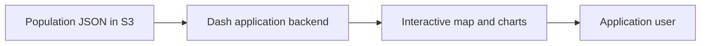

# Population dashboard — planned

This directory is intended to contain an interactive application for exploring World Bank population data using Dash and Plotly.

**Status: planned.** This document describes an initial design, not implemented functionality. The architecture, features, data access, and hosting choices may evolve as the application is developed.

## Proposed data flow

The ingestion pipeline writes enriched population records to S3. The application backend is expected to read that data and provide it to visualisations. Users would interact with the application without needing direct access to the bucket.

See the [ingestion README](../ingestion/README.md) for how the data is produced. Authentication, refresh behaviour, caching, and hosting remain design decisions to be tested.

## Intended features

- An interactive world map showing population by economy.
- Selection and comparison of economies.
- Clear separation of individual economies and World Bank aggregate groups.
- Historical charts and comparisons once the ingestion pipeline provides historical data.

The current dataset contains the latest available observations, not a full time series. Observation years may differ between economies, so the application should show the year alongside values and handle missing population data.

## Possible conversational interface

A future chatbot could answer questions about the available data through an authorised data-access tool. The questions it should support, how results are validated, and whether an agent, MCP, or retrieval system is appropriate are still to be determined. A vector database is not assumed by this design.

## Development and deployment

Application code, dependencies, a Dockerfile, tests, and a deployment method will be documented here as they are implemented. The ingestion component already has its own deployment workflow; the app's hosting and deployment are not yet established.
