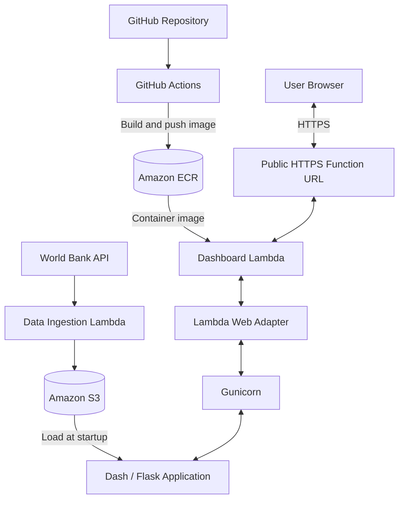

# 🌍 Population Dashboard

An interactive Dash and Plotly application for exploring historical World Bank population data, deployed as a containerized web application on AWS Lambda.

**Status: Deployed and publicly accessible.**

### 🚀 Live Application

[**Explore the World Population Dashboard**](https://kgywd5fzmf347xiiw2rlz73hm40eiyby.lambda-url.eu-north-1.on.aws/)

Rotate the globe, select an economy, and explore its historical population trends.

The application is hosted on AWS Lambda and uses a public HTTPS Function URL. Initial loading may take longer when AWS needs to initialize a new execution environment.

### 🎬 Demo

[](https://github.com/user-attachments/assets/46d89bdf-68b5-4020-8db1-f4d24c757e42)

---

## Features

### Interactive Globe

- Rotatable globe using Plotly's orthographic projection.
- Logarithmic Viridis colour scale representing population.
- Hover information showing actual population values and observation years.
- Geographic selection of individual economies, including territories.
- World Bank aggregate groups excluded from the globe.
- Population data displayed for the latest year with sufficient geographic coverage.

### Country Details Panel

Selecting an economy opens a panel displaying:

- Economy name.
- Latest available population.
- Observation year.
- Historical population time-series chart.

Selecting another economy updates the panel.

The clear-selection feature resets the panel and allows the same economy to be selected again.

The callback updates the details panel without replacing the globe figure. A stable `uirevision` helps preserve the map's interaction state across updates.

### Responsive Interface

Custom CSS provides:

- Side-by-side globe and details panels on desktop.
- Stacked layout for smaller screens.
- Consistent typography, spacing, and chart containers.

---

## Architecture

The application separates data ingestion, cloud storage, and interactive visualization.



The ingestion and dashboard Lambdas are separate AWS functions with different responsibilities.

### Data Pipeline

1. The ingestion Lambda retrieves World Bank population observations.
2. Records are enriched using country metadata.
3. The resulting JSON dataset is stored in Amazon S3.
4. The dashboard loads the dataset from S3 during application initialization.
5. pandas prepares the data for visualization and filtering.

For ingestion implementation details, see [the ingestion guide](../ingestion/README.md).

### Application Deployment

1. GitHub Actions executes the project's CI workflow.
2. The dashboard Docker image is built using `dash_app/Dockerfile`.
3. GitHub Actions authenticates to AWS using OIDC.
4. The built image is pushed to Amazon ECR.
5. The AWS Lambda dashboard function references the published ECR image.
6. Lambda starts or reuses a containerized execution environment when invoked.
7. Lambda Web Adapter forwards HTTP requests to Gunicorn.
8. Gunicorn serves the Flask application underlying Dash.
9. Dash processes Python callbacks and returns results to the browser.

The public HTTPS endpoint is associated with the dashboard Lambda function.

**Important:** Building and publishing dashboard images is automated. Updating the dashboard Lambda to use a newly built image is currently a separate, manual deployment step.

---

## Client-Side and Server-Side Processing

The application uses both browser-side interactions and server-side Python callbacks.

### Client-Side

Plotly.js handles interactions such as rotating the globe directly in the browser.

These operations do not necessarily require additional Lambda invocations.

### Server-Side

When an economy is selected:

1. The browser sends a Dash callback request.
2. The Lambda Function URL receives the HTTPS request.
3. Lambda Web Adapter forwards it to Gunicorn.
4. Dash executes the corresponding Python callback.
5. The callback filters the in-memory pandas DataFrame.
6. The updated chart and country information are returned to the browser.

Country selection does not require new World Bank API requests or S3 downloads.

---

## Data Handling

The population dataset is retrieved from:

```text
s3://webgis-population-app/data/enriched_population_data.json
```

At application startup:

1. Boto3 retrieves the dataset.
2. Records are converted into a pandas DataFrame.
3. Observation years are converted to integers.
4. Aggregate records are excluded from individual-economy views.
5. The latest year containing valid population observations for more than 200 economies is selected.
6. The initial globe figure is generated.

### In-Memory Data

The dataset is loaded once per Python application process.

Subsequent server-side callbacks reuse the DataFrame rather than repeatedly querying S3.

Each independently initialized Lambda execution environment maintains its own application memory.

**Current limitation:** Updating the dataset in S3 does not automatically refresh an already running application process.

Newly initialized environments load the latest available dataset, while warm environments may continue serving an older snapshot.

---

## Map and Chart Behaviour

### Globe

The globe uses the latest year meeting the geographic coverage threshold.

Only individual economies with valid population values and non-empty ISO3 codes are included in the data used to construct the globe.

Population values are transformed using a base-10 logarithm for colour mapping.

The colour scale displays population magnitudes, while hover information shows the original values.

Missing population observations are not replaced with zero.

### Historical Population Chart

The details panel displays the selected economy's historical population observations in chronological order.

The most recent available observation may differ from the year represented on the globe. Both are labelled accordingly.

Missing values remain missing rather than being interpreted as zero.

If no usable history is available, the details panel displays an appropriate message.

---

## Technology Stack

| Component | Technology |
| --- | --- |
| Programming language | Python 3.13 |
| Data processing | pandas, NumPy |
| Interactive dashboard | Dash |
| Visualization | Plotly |
| Cloud storage | Amazon S3 |
| Web server | Gunicorn |
| Containerization | Docker |
| Container registry | Amazon ECR |
| Serverless deployment | AWS Lambda |
| HTTP integration | AWS Lambda Web Adapter |
| CI / Image publishing | GitHub Actions |
| Cloud authentication | GitHub OIDC and AWS IAM |
| Testing | pytest |
| Logging | Amazon CloudWatch |

---

## Repository Files

| File | Responsibility |
| --- | --- |
| `app.py` | S3 loading, data preparation and application initialization |
| `data.py` | S3 reading, year conversion and data filtering |
| `layout.py` | Dash layout and interface components |
| `ui.py` | Globe and historical chart construction |
| `callbacks.py` | Country selection and clear-selection callbacks |
| `assets/style.css` | Styling and responsive layouts |
| `requirements.txt` | Application and production dependencies |
| `Dockerfile` | Production container image configuration |
| `tests/` | Dashboard tests |
| `eda/` | Exploratory analysis notebook |

The deployment workflow is located at:

```text
.github/workflows/deploy_dashapp.yml
```

---

## Running Locally

Use Python 3.13.

From the repository root, install the dependencies:

```powershell
python -m pip install -r requirements-dev.txt -r dash_app/requirements.txt
```

Ensure AWS credentials are configured with permission to read the dataset in S3.

If using a named AWS profile:

```powershell
$env:AWS_PROFILE = "your-profile-name"
```

Start the dashboard:

```powershell
python -m dash_app.app
```

Open:

```text
http://127.0.0.1:8050
```

The local entry point runs Dash in development mode.

The production deployment uses Gunicorn instead.

---

## Docker Configuration

The production image uses `python:3.13-slim`.

It includes:

- Python application dependencies.
- Dashboard source code and CSS assets.
- AWS Lambda Web Adapter.
- Gunicorn as the production web server.

Gunicorn listens on port `8080`.

The Lambda Web Adapter forwards incoming Lambda requests to the application server running on that port.

The production application is exposed through:

```python
server = app.server
```

Gunicorn loads the application using:

```text
dash_app.app:server
```

The Docker image can be built from the repository root using:

```powershell
docker build -f dash_app/Dockerfile -t population-dashboard .
```

Docker Desktop is not required for the GitHub Actions deployment because the image is built on a GitHub-hosted runner.

---

## AWS Deployment

### Current Status

| Component | Status |
| --- | --- |
| Production Dockerfile | Implemented |
| Gunicorn configuration | Implemented |
| Lambda Web Adapter | Implemented |
| Dashboard ECR repository | Created |
| GitHub Actions image build | Implemented |
| GitHub OIDC authentication | Implemented |
| Dashboard Lambda function | Deployed |
| Lambda execution role | Configured |
| S3 read permissions | Configured |
| Public HTTPS Function URL | Configured |
| Automatic Lambda image update after build | Pending |

### Building and Publishing an Image

The GitHub Actions dashboard workflow is manually triggered from `main`.

It performs the following operations:

1. Run CI.
2. Authenticate to AWS through OIDC.
3. Build the Docker image for `linux/amd64`.
4. Push the image to Amazon ECR.
5. Record the image URI in the workflow summary.

Each image receives a uniquely generated tag.

### Updating the Dashboard Lambda

After a successful image build, copy the new ECR image URI from the GitHub Actions workflow summary.

Then update the Lambda function using the AWS CLI:

```powershell
$imageUri = "<NEW_ECR_IMAGE_URI>"

aws lambda update-function-code `
  --function-name population-dashboard `
  --image-uri $imageUri `
  --region eu-north-1
```

Wait for the deployment to finish:

```powershell
aws lambda wait function-updated-v2 `
  --function-name population-dashboard `
  --region eu-north-1
```

Finally, verify the application using its public HTTPS URL.

### AWS Permissions

Two IAM roles serve different purposes:

**GitHub deployment role**

Allows GitHub Actions to authenticate with AWS and push Docker images to ECR.

**Dashboard Lambda execution role**

Allows the running application to access its required AWS resources, including:

- Reading the population dataset from S3.
- Writing application logs to CloudWatch.

The browser does not need AWS credentials or direct access to the S3 bucket.

Credentials must not be embedded in application code or Docker images.

---

## Testing

From the repository root:

```powershell
python -m pytest -q
```

To run only the dashboard tests:

```powershell
python -m pytest dash_app/tests -q
```

The tests cover:

- Successful and failed S3 reads.
- Year conversion and invalid-year handling.
- Economy filtering.
- Chronological ordering.
- Globe data and logarithmic population values.
- Historical chart generation.
- Country selection and clearing.
- Missing or unknown selections.
- Initial chart state.
- Viridis colour scale preservation.

### Manual Browser Testing

Automated Python tests do not guarantee correct browser rendering.

The following interactions require manual verification:

1. Globe initialization and rotation.
2. Economy selection.
3. Country details panel updates.
4. Clearing and repeating selections.
5. Historical chart layout.
6. Browser resizing and responsive layout.
7. Public Lambda URL accessibility.

---

## Monitoring and Costs

The application uses AWS Lambda for on-demand execution rather than maintaining an always-running EC2 server.

This is suitable for a portfolio application with intermittent traffic.

The main tradeoffs include:

- Cold-start latency.
- Lambda invocation timeouts.
- Concurrency limits.
- Repeated startup work across separate execution environments.

AWS CloudWatch provides invocation logs, errors, duration and memory usage metrics.

A monthly AWS budget and billing notifications can help monitor spending, but budget alerts do not enforce a hard spending limit.

---

## Known Limitations

- The dataset is not automatically refreshed within an existing Python application process.
- Separate Lambda environments may temporarily serve different data snapshots.
- Startup requires access to the S3 dataset.
- AWS configuration values are currently defined in Python.
- No multi-economy comparison feature.
- No interactive map-year selector.
- Browser-side rotation and resizing still require testing.
- The orthographic globe may collapse during extreme vertical rotation; resetting the rotation restores the view.
- No comprehensive Great Expectations validation suite yet.
- Dashboard Lambda image updates are not yet fully automated.

---

## Planned Improvements

### Data Engineering

- [ ] Add broader data-quality validation.
- [ ] Implement scheduled data ingestion.
- [ ] Introduce metadata for dataset freshness.
- [ ] Add a cache-refresh strategy for updated S3 datasets.
- [ ] Preserve the last successfully loaded dataset if refresh fails.

### Deployment and Application

- [ ] Automate dashboard Lambda image updates in GitHub Actions.
- [ ] Improve cold-start performance.
- [ ] Investigate the Plotly globe-rotation issue.
- [ ] Improve responsive behaviour across devices.
- [ ] Add automated browser interaction tests.

### Future Extension: Agentic Analytics

A possible future extension is an MCP-powered World Bank data exploration workflow.

The objective would be to let users:

- Ask natural-language questions about World Bank indicators.
- Discover available indicators and their metadata.
- Retrieve relevant observations.
- Run validated analytical queries.
- Generate interactive visualizations.
- Inspect the data sources and transformations behind generated results.

This extension is planned and is not part of the currently deployed dashboard.

---

## Data Source

Population observations are retrieved from the World Bank:

[SP.POP.TOTL — Population, total](https://data.worldbank.org/indicator/SP.POP.TOTL)

[World Bank Indicators API documentation](https://datahelpdesk.worldbank.org/knowledgebase/topics/125589-developer-information)

World Bank economies include territories as well as sovereign countries. Aggregate groups are retained in the source dataset but excluded from individual-economy visualizations.

Please refer to the World Bank's applicable attribution and usage terms when redistributing data.

---

## Project Repository

[World Population Interactive Visualisation](https://github.com/Seif-Wessam/world-population-interactive-visualisation)
