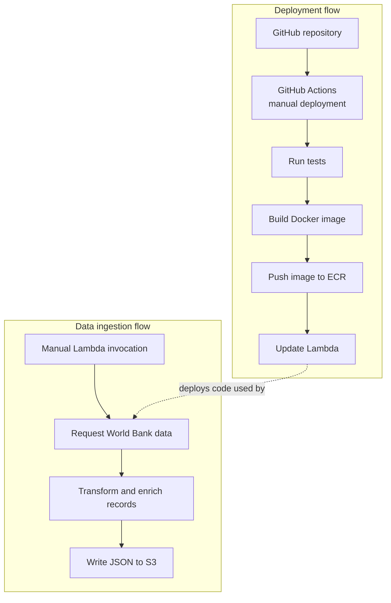

# Population ingestion

This component retrieves annual population observations from 1970 through the current calendar year and country metadata from the World Bank. It enriches the observations and writes the result to Amazon S3. It is deployed as an AWS Lambda container image.

## Data flow

The data flow follows the following diagram:


1. Request the population observations and country metadata, using `per_page=3000`.
2. Read the pagination metadata and retrieve all reported pages for both endpoints.
3. Check page metadata and verify the combined count against the API total.
4. Build simplified population records and a metadata lookup keyed by `iso2Code`.
5. Match each observation's `country.id` to the lookup; add its region and aggregate flag.
6. Serialize the enriched records as JSON and upload them to S3.

If an API request or pagination check fails, the error propagates and the S3 write is not called. The existing object is left untouched by that failed retrieval. Retries and saving partial pages are not yet implemented.

The World Bank response contains individual economies and aggregate groups. The current classification marks an entry as an aggregate when the metadata region ID is `NA`. Economies can include territories as well as sovereign countries.

Example output record:

```json
{
  "country": "Africa Eastern and Southern",
  "country_id": "ZH",
  "country_iso3": "AFE",
  "date": "2025",
  "population": 788844284,
  "region": "Aggregates",
  "is_aggregate": true
}
```

A missing population is stored as JSON `null`. When a population record has no matching metadata, `region` and `is_aggregate` are `null`. Observation dates are strings. The output is written to the configured bucket under `data/enriched_population_data.json`; another successful run writes to the same key.

## Files

- `lambda_function.py`: API requests, transformation, S3 write, and Lambda handler.
- `requirements.txt`: runtime dependencies.
- `Dockerfile`: definition of the Lambda-compatible image.
- `../tests/test_population.py`: transformation and ISO3 preservation tests.
- `../tests/test_world_bank_api.py`: pagination and request-failure tests.
- `../tests/test_ingestion_handler.py`: handler success-path test.

## Run locally

From the repository root in PowerShell, install dependencies and run the tests:

```powershell
python -m pip install -r requirements-dev.txt
python -m pytest -q
```

To run the complete ingestion locally, authenticate with AWS and select your profile:

```powershell
aws login --profile population-dev --region eu-north-1
$env:AWS_PROFILE = "population-dev"
python .\ingestion\lambda_function.py
```

This runs the handler and **writes to the S3 bucket configured in the code**. Your AWS identity needs permission to put an object there. The script does not print the handler's return value when run this way. Use an appropriately scoped development bucket when experimenting.

## Build and test the image locally

From the repository root, with Docker Desktop running:

```powershell
docker buildx build --platform linux/amd64 --provenance=false --load -t population-lambda:local ./ingestion
```

Start the local Lambda container:

```powershell
docker run --rm --name population-local --platform linux/amd64 -p 127.0.0.1:9000:8080 population-lambda:local
```

In a second PowerShell window, invoke it:

```powershell
$result = Invoke-RestMethod -Uri "http://localhost:9000/2015-03-31/functions/function/invocations" -Method Post -Body '{}' -ContentType 'application/json'
$result.statusCode
```

The current handler writes to S3, so this invocation also needs AWS credentials available **inside the container** and network access; local CLI login is not automatically inherited. The container can start without them, but an invocation requiring S3 may fail. Stop it with Ctrl+C in the first window.

## Deploy to AWS

1. Commit and push the intended code and dependency changes.
2. In GitHub, open **Actions → Deploy ingestion to dev → Run workflow** and select `main`.
3. Check that tests, AWS authentication, image build and upload, and Lambda update succeed.
4. Invoke the Lambda with a test event such as `{}`. Check the execution result and logs.
5. Check the S3 object's last-modified time and inspect its content.

The deployment workflow calls the reusable CI workflow and waits for it to pass. It then builds from `ingestion/`, pushes a uniquely tagged image to ECR, and updates the existing Lambda. It does not invoke the function. GitHub uses OIDC to assume a deployment role configured via the `AWS_DEPLOY_ROLE_ARN` repository variable. The Lambda uses a separate execution role that needs permission to write to S3.

## Runtime and verification

The handler returns a compact success summary with the record count and serialized JSON size in bytes. It does not return the full dataset. The S3 object contains the records.

In one successful historical ingestion run, the handler reported 14,896 records and 2,532,761 JSON bytes. At the time of that run, Lambda had 128 MB allocated and reported 105 MB maximum memory use and about 11.4 seconds duration. The configuration was subsequently changed to 256 MB and a 60-second timeout. These are observations and settings at the time of the run, not guarantees for future runs.

To check a new deployment, invoke the Lambda separately and review the response, the `REPORT` line in the logs, and the S3 object's last-modified time and contents. The write replaces the existing object at the configured key.

## Reliability and validation

The ingestion pipeline includes several checks to reduce the risk of publishing
an incomplete dataset:

- Both World Bank endpoints are paginated automatically.
- Pagination metadata is checked across requests.
- The number of retrieved records is compared with the API's reported total.
- If an API request or pagination check fails, the error stops the run before
  the S3-writing step.
- Automated tests cover multi-page retrieval, ISO3 preservation, and simulated
  failures during population and metadata requests.
- The deployed Lambda has been invoked successfully and its S3 output inspected.

These checks improve confidence in ingestion, but matching counts alone does not
prove that every record is correct or that the source remained unchanged between
page requests.

## Data interpretation

- The dataset includes annual observations from 1970 onward, as provided by the
  World Bank.
- Missing population values are preserved as `null`; they should not be
  interpreted as zero.
- The output includes both individual economies and aggregate groups, identified
  by `is_aggregate`.
- Three-character codes are preserved for map matching, but some may be missing
  or unsupported by the visualisation provider.

## Planned data-quality validation

The pipeline currently checks pagination metadata and the number of retrieved
records before writing to S3. These checks help detect incomplete API responses,
but they do not validate the quality of every data value.

A future Great Expectations suite will provide additional checks to reduce the
risk of passing incorrect or incomplete data to the application.

Candidate checks include:

- Required columns are present.
- Country identifiers and observation years are populated.
- Observation years fall within the requested range.
- Population values are non-negative when present.
- Missing population values are measured and reported rather than treated as zero.
- Duplicate country-and-year combinations are identified.
- Missing ISO3 codes and unmatched country metadata are measured and reported.
- Aggregate groups are distinguished from individual economies.

The dataset will first be profiled to establish appropriate rules and
thresholds. We will then decide which failures should stop publication to S3
and which should produce a warning.

**Status: planned.** Great Expectations validation is not yet implemented.

## Dashboard consumer

The [Dash application](../dash_app/README.md) now reads the enriched S3 object and
provides a globe and country history charts. It uses a separate read-only execution
role and deployment workflow. The dashboard caches data per worker; redeploy it
after ingestion when an immediate refresh is required.

## Future improvements

- Add retries and consider recovery of partial runs.
- Move the bucket name out of the Python code for environment-specific
  configuration.
- Add further live integration checks and data-quality validation as needed.

Data source: [World Bank Indicators API](https://datahelpdesk.worldbank.org/knowledgebase/topics/125589-developer-information).
